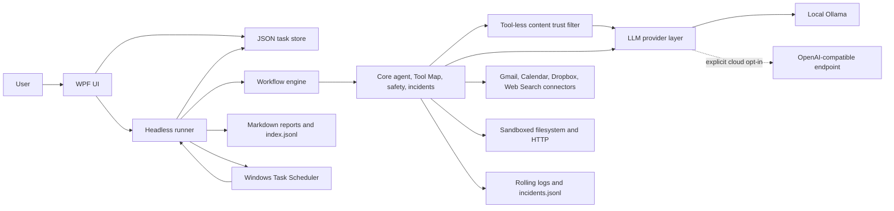

# OD.MyLocalAgent

OD.MyLocalAgent is a native Windows desktop application for running scheduled, AI-driven
tasks locally. It combines a WPF management UI, a headless runner, Ollama, deterministic
workflows, a guarded tool layer, and rolling Windows Task Scheduler registrations.

The default AI provider is local Ollama. An OpenAI-compatible provider is available only as
an explicit cloud opt-in. Published UI and runner executables are self-contained and are
installed in sibling `UI` and `Runner` directories so scheduled actions never depend on a
development `bin` directory.

Standalone offline HTML5 user guides are available in
[French](Docs/User-Manual.html) and [English](Docs/User-Manual.en.html). Each guide contains
its own navigation, search, styles, and scripts in one file.

## Product status

| Stage | Scope | Status |
|---|---|---|
| 0 | Solution foundation and toolchain | Complete |
| 1 | LLM providers and cloud connectors | Complete |
| 2 | Core services, tools, safety, incidents, scheduler | Complete |
| 3 | Workflows, reports, and headless runner | Complete |
| 4 | WPF shell, diagnostics, and settings | Complete |
| 5 | Task, prompt, connector, tester, and playground pages | Complete |
| 6 | Hardening, self-contained packaging, documentation, acceptance | Complete with documented human checks |
| 7 | Prompt-injection trust filter for Gmail and HTTP GET content | Complete with documented manual UI/provider checks |
| 8 | Ollama cloud Web Search with mandatory Guardrails protection | Complete with documented live-key/UI checks |
| 9 | Not implemented |
| 10 | Not implemented |
| 11 | PER-TASK FILE-SYSTEM AUTHORIZATION | Complete |
| 12 | Sequential workflow context & guided JSON authoring | Complete |
| 13 | AI Workflow Helper | Complete |
| 14 | Hierarchical AI Generation Settings | Complete |
| 15 | Not Implemented |
| 16 | Windowless Runner and Run Monitor | Complete |
| 17 | Deterministic workflow authoring aids: Tool catalog and Workflow prompt editor | Complete with documented human GUI checks |
| 18 | Compact External-Content Guardrails | Complete |
| 18A | Extensible Tool Integration Foundation | Complete with automated verification |
| 18C | File-system Recycle Bin and document conversions | Complete with automated verification |
| 18D | Declarative Dynamic Tooling | Complete with automated verification |
| 19 | SQLite Tool | TO DO |
| 20 | Agent Prompt Placeholders | Complete with documented, human task test done |
| 21 | Model Information Placeholders | Complete with automated verification |
| 22 | Archive, Office, and PDF Tools | TO DO |
| 23 | Web Discovery, Retrieval, Research Storage, and named Storage Spaces | Specified — TO DO |
| 24 | Publications and Markdown Reports | Specified — depends on Stage 23 |
| 25 | Human Workflow Text Editing with advanced JSON mode | Specified — TO DO |

See [Docs/acceptance-report.md](Docs/acceptance-report.md) for the executed acceptance
evidence and any remaining environment-dependent checks.

## Prerequisites

- Windows 10 or Windows 11, x64 by default.
- PowerShell 7 or Windows PowerShell 5.1 for `scripts/publish.ps1`.
- .NET 10 SDK for building from source. The published applications are self-contained and do
  not require a separately installed .NET runtime.
- Ollama 0.32.5 or later, or another Ollama release that supports the configured
  `gemma4:12b` tag. Version 0.32.5 is the verified project baseline.
- A local model matching the exact configured tag:

```powershell
ollama --version
ollama pull gemma4:12b
ollama list
```

`ollama list` must contain `gemma4:12b`. A similar name or a different tag does not satisfy
the health check.

Google Cloud, Dropbox, and ollama.com accounts are optional. They are required only for
workflows that enable those cloud tool groups.

## Quick start

From the repository root, publish the self-contained UI and runner:

```powershell
.\scripts\publish.ps1
```

The default destination is:

```text
%LOCALAPPDATA%\Programs\OD.MyLocalAgent
```

The script publishes both projects in Release mode for `win-x64`, verifies the two
executables, copies `appsettings.json`, then prints the resolved runner path. A custom
destination or runtime identifier can be supplied:

```powershell
.\scripts\publish.ps1 `
  -DestinationPath 'D:\Apps\OD.MyLocalAgent' `
  -RuntimeIdentifier win-x64
```

Start:

```text
%LOCALAPPDATA%\Programs\OD.MyLocalAgent\UI\OD.MyLocalAgent.UI.exe
```

On first launch:

1. Open **Settings** and confirm the Ollama endpoint, model, filesystem root, scheduler
   options, and safety defaults. The Ollama model field is an editable list populated from
   the models installed on the configured endpoint; use **Refresh models** after changing the
   endpoint or installing a new model.
2. Select **Test connection**. A healthy result requires both a reachable endpoint and the
   exact configured model tag.
3. Open **Tools** to authorize Google, store Dropbox credentials, or explicitly enable the
   Ollama cloud Web Search provider when those integrations are needed.
4. Create a task. Prefer an explicit workflow for unattended execution.

The default `Settings -> Scheduler:RunnerPath` value is empty. This is intentional:
auto-resolution first checks beside the UI and then selects
`..\Runner\OD.MyLocalAgent.Runner.exe` in the standard published layout. An explicit
absolute override remains supported.

Settings also exposes separate copy actions for the reports directory and the published UI
executable directory. **Create desktop shortcut** creates or refreshes
`OD.MyLocalAgent.lnk` on the current user's Windows desktop and targets the published UI
executable. Application confirmation dialogs use the active Light or Dark theme; native
file and folder pickers continue to use the Windows appearance.

## Google Cloud OAuth setup

OD.MyLocalAgent requests these scopes:

| API | Scope |
|---|---|
| Gmail read | `https://www.googleapis.com/auth/gmail.readonly` |
| Gmail send | `https://www.googleapis.com/auth/gmail.send` |
| Calendar | `https://www.googleapis.com/auth/calendar` |

Configure Google Cloud as follows:

1. Create or select a Google Cloud project.
2. Enable the **Gmail API** and **Google Calendar API**.
3. Configure the OAuth consent screen. Add the intended account as a test user while the app
   remains in testing.
4. Create an OAuth client with application type **Desktop app**.
5. Close OD.MyLocalAgent and add the client id and client secret to
   `%LOCALAPPDATA%\OD.MyLocalAgent\settings.json`:

```json
{
  "Google": {
    "ClientId": "YOUR_DESKTOP_CLIENT_ID",
    "ClientSecret": "YOUR_DESKTOP_CLIENT_SECRET"
  }
}
```

The full settings file may contain other sections; do not remove them. Settings saves
preserve the `Google` section. Reopen the UI, go to **Tools**, and select **Connect**. The
interactive browser consent must be completed under the same Windows account that will run
scheduled tasks.

Refreshable Google authorization data is stored under:

```text
%LOCALAPPDATA%\OD.MyLocalAgent\Auth\Google
```

The runner never starts an interactive browser. If consent is missing or expired beyond
silent refresh, authorize again from the UI.

## Dropbox app setup

1. Create an app in the Dropbox App Console.
2. Choose the narrowest access type that covers the workflow, preferably an app folder.
3. Enable the file permissions required by the selected aliases: metadata read, content read,
   and content write as appropriate.
4. Obtain either:
   - an access token; or
   - a refresh token plus the app key.
5. In **Tools -> Dropbox**, enter the replacement values and select **Save credentials**.
6. Use **Test connection** before scheduling Dropbox workflows.

Dropbox values are write-only in the UI. They are persisted in the DPAPI CurrentUser secret
store, never in `settings.json`.

## Web search (Ollama)

Web search is disabled on a fresh install because it sends the query to the Ollama cloud API.
To enable it:

1. Create an ollama.com account and obtain a Web Search API key.
2. Open **Tools -> Web search (cloud)**.
3. Enable Web search, keep
   `https://ollama.com/api/web_search` unless you intentionally use an approved compatible
   endpoint, paste the write-only API key, and select **Save**.
4. Select **Test connection**. The UI reports only latency and result count; it does not show
   the fixed test query or returned snippets.
5. Enable the **Web search (web) (cloud)** checkbox only on tasks that need it.

The API key is protected through Windows DPAPI and never written to `settings.json`. Search
queries and result snippets leave the computer. A custom endpoint receives both the key and
the queries, so configure one only when you trust its operator. Ollama describes a free tier
for individuals, but does not publish stable request limits; burst traffic may be throttled.

`web.search` accepts `query` and optional `maxResults` (default 5, capped at 10). It returns
one compact `protectedResults` block. Titles and snippets are serialized into one canonical
JSON array, deterministically bounded to `Guardrails:MaxContentChars`, and screened exactly
once before delivery. Overflow is explicitly truncated or omitted and counted. Source index
and URL are metadata outside the screened block; they are removed when content is withheld.
Clean content is marked plaintext, caution content is marked Base64, and low-trust content is
withheld. Disabled or failed screening still uses marked Base64—there is no raw fallback.

Stage 8 implements Ollama only, behind a provider-neutral connector boundary so a later local
provider such as SearXNG can be added without changing the Tool Map or workflow contract.

## Configuration and data locations

Configuration is loaded in this order, with later layers winning:

1. `appsettings.json` beside the executable, using `AppContext.BaseDirectory`.
2. `%LOCALAPPDATA%\OD.MyLocalAgent\settings.json`, optional and reloadable.
3. An in-memory layer populated from the DPAPI secret store at bootstrap.

The process working directory is never used to locate configuration.

| Location | Purpose |
|---|---|
| `%LOCALAPPDATA%\Programs\OD.MyLocalAgent\UI\` | Default self-contained WPF application directory |
| `%LOCALAPPDATA%\Programs\OD.MyLocalAgent\Runner\` | Default self-contained headless runner directory |
| `%LOCALAPPDATA%\OD.MyLocalAgent\settings.json` | Non-secret user overrides |
| `%LOCALAPPDATA%\OD.MyLocalAgent\secrets.dat` | DPAPI CurrentUser-protected OpenAI, Dropbox, and Web Search secrets |
| `%LOCALAPPDATA%\OD.MyLocalAgent\Auth\Google\` | Google OAuth token data |
| `%LOCALAPPDATA%\OD.MyLocalAgent\tasks\<id>.json` | One validated definition per task |
| `%LOCALAPPDATA%\OD.MyLocalAgent\reports\<taskId>\*.md` | Per-run Markdown reports |
| `%LOCALAPPDATA%\OD.MyLocalAgent\reports\index.jsonl` | Append-only execution index |
| `%LOCALAPPDATA%\OD.MyLocalAgent\logs\application-<date>.log` | Rolling application logs, retained for 14 files |
| `%LOCALAPPDATA%\OD.MyLocalAgent\logs\runs\<taskId>\*.jsonl` | Per-execution runner output logs (`Logging:MaxRunLogsPerTask` retained per task, default 50) |
| `%LOCALAPPDATA%\OD.MyLocalAgent\logs\incidents.jsonl` | Durable incidents with correlation ids |
| `%LOCALAPPDATA%\OD.MyLocalAgent\logs\archive\<timestamp>\` | Log copies created by Diagnostics Reset |

The DPAPI keys are `OpenAI:ApiKey`, `Dropbox:AccessToken`, `Dropbox:RefreshToken`,
`Dropbox:AppKey`, and `WebSearch:ApiKey`. They must not be added to either JSON configuration
file.

## AI generation policy

**Settings → AI generation defaults** defines the policy used by new AI calls:

| Setting | Default | Valid range | Meaning |
|---|---:|---:|---|
| Temperature | `0.2` | finite `0`–`2` | Sampling variability |
| Top P | `1.0` | finite, greater than `0` and at most `1` | Nucleus-sampling threshold |
| Context window | `8192` | `1024`–`2000000` | Declared total request budget, not an output-token limit |

Tune Temperature or Top P first instead of changing both at once. The context window covers
input messages, agent/tool context, and generated output; it cannot increase the selected
model's physical capacity and does not silently truncate, summarize, or discard content.
Changes are reloadable: a new call sees the saved values, while an already-running call keeps
the immutable snapshot with which it started.

A task may override Temperature and Top P independently:

```json
"generationOptions": {
  "temperature": 0.1
}
```

An object-form AI workflow step may override either value again:

```json
{
  "step": "ai.prompt",
  "id": "draft",
  "args": {
    "prompt": "Draft three titles from {{source.output}}."
  },
  "generationOptions": {
    "topP": 0.9
  }
}
```

Each property resolves separately:

```text
AI step override → task override → Settings default
```

In the example, the step uses task Temperature `0.1` and step Top P `0.9`. Missing properties
inherit; they do not reset the other property. Context is global only. `generationOptions`
is valid only at task level and on object-form `ai.*` steps; unknown fields, nulls, invalid
ranges, and use on non-AI steps are rejected. Existing tasks without this object remain valid,
and empty objects are omitted when a task is saved.

Prompt editor Test displays and uses the current unsaved task-effective values. Workflow AI
steps display configured overrides and deterministic provenance through AI Explain. The AI
playground has no task, so it displays and uses the global policy.

Workflow authoring/refinement/repair, workflow explanation/repair, Guardrails screening, and
Guardrails reduction deliberately use program-owned Temperature `0` and Top P `1`. User
defaults and task/step overrides cannot change these deterministic internal policies, but they
still receive the current global context-window value.

Ollama receives the context window through its native `num_ctx` request option. OpenAI-compatible
models generally own a fixed context capacity and this application does not invent a request
field for it; the configured value remains the application's declared budget and the provider
is authoritative. Provider context errors follow the normal execution and incident paths.
Temperature and Top P semantics can vary slightly by provider and model, and provider
tokenization is authoritative rather than a universal exact counter. Tuning both sampling
controls at once can make results harder to predict; higher randomness can reduce
structured-output and tool-selection reliability. OpenAI-compatible endpoints may also reject
sampling ranges or oversized requests that another provider accepts.

## Safety defaults

The following side effects are disabled by default:

| Alias | Required opt-in |
|---|---|
| `gmail.send` | `Safety:AllowSendEmail` |
| `filesystem.delete` | `Safety:AllowFileDelete` |
| `filesystem.moveToBin` | `Safety:AllowMoveToBin` |
| `http.post` | `Safety:AllowHttpPost` |

A blocked operation throws `SafetyException` and names the required flag. This design keeps a
task definition, model response, or imported workflow from silently sending mail, deleting
files, moving files to the Windows Recycle Bin, or issuing outbound POST requests.

Relative filesystem paths are confined to the absolute `FileSystem:RootPath`. A task may
authorize additional absolute directories in its **Authorized locations** editor section;
each location is read-only or read-write. Absolute paths without a matching task rule,
parent traversal, sibling-prefix confusion, and reparse-point escapes are rejected. Dropbox
local paths use the same policy, and Windows ACLs remain authoritative.
`Http:AllowedHosts` is an exact hostname allowlist.
An empty list allows every HTTP or HTTPS host; that is convenient for interactive use but
increases unattended-network risk, so production tasks should use an explicit list.

Tool results such as email bodies, web pages, and local files are untrusted data. They may
contain prompt-injection text that asks the model to ignore policy, reveal secrets, or invoke
a dangerous tool. The agent system prompt explicitly tells the model never to treat tool
results as instructions. Safety flags, tool whitelists, the filesystem sandbox, and the HTTP
allowlist remain the enforceable boundaries even when model output is manipulated.

## Prompt-injection guardrails

Gmail reads, HTTP GET/GET Text responses, and Web Search result sets pass through the active
provider's dedicated classifier before they are returned to an agent. Gmail and HTTP first
build deterministic projections no longer than `Guardrails:MaxContentChars`; omitted text is
discarded before any model call and is represented only by character counts and markers. This
compaction is a data-minimization boundary, not a claim that omitted text was safe.

Compact Gmail items are processed in stable batches of at most 12 items and six times the
per-item character limit. Each eligible batch makes at most three direct `IChatClient` calls:
source screening, factual summarization, and final-summary screening. Calls use temperature
zero, Top P one, strict id-correlated JSON, no tools, skills, agent loop, memory, or side
effects. A malformed or failed phase fails closed for that batch, records one sanitized
incident, does not replay items individually, and allows later batches to continue.

Every delivered external-content block is marked. A clean result uses a plaintext warning
and nonce-bound `UNTRUSTED-EXTERNAL-DATA` delimiters. A caution result, disabled LLM
processing, or a screening failure uses a marked UTF-8 Base64 payload inside
`UNTRUSTED-EXTERNAL-DATA-BASE64` delimiters. A score below the caution threshold withholds
the content.

| Result | Default threshold | Delivery |
|---|---:|---|
| Clean | `score >= 80` | Marked plaintext |
| Caution | `50 <= score < 80` | Marked Base64 |
| Low trust | `score < 50` | Withheld marker |
| Screening disabled or failed | no score | Marked Base64 for normal-size content |

Turning **Use LLM guardrails processing** off does not disable protection and never enables
raw pass-through. Gmail then returns bounded projected From/To/Subject/Received headers plus
an application-authored review marker in marked Base64; Snippet and Body are never delivered.

Every Gmail read alias projects all in-limit messages before LLM work. Successful messages
contain only projected From, To, Subject, Received, and a labeled factual summary; Snippet,
Body, quoted reply history, and capped suffixes cannot enter workflow context. The effective
score is the minimum source/final-summary score. A positive Gmail limit still processes only
the first N messages with explicit counts and a warning; `0` remains unlimited. Progress and
performance logs are batch-oriented and contain aggregate counts only.

`http.get` keeps its raw-response purpose but delivers only one protected media-aware compact
prefix: JSON is minified, text/XML is normalized, HTML uses readable extraction, and binary or
unsupported media becomes an application-authored marker. It is screened once and never
summarized. `http.getText` removes non-content HTML, prefers main/article/body, summarizes one
compact readable projection, screens the generated summary, and delivers that summary only.
Both aliases expose original/projected/omitted character counts and a truncation flag.

Per-item verdict and summary results remain cached in memory for 24 hours by prompt version,
provider, model, requested maximum, and content hash. Batch membership, order, opaque id,
nonce, and neighbors never enter cache identity. The legacy complete-source reducer remains
available to the Trust filter and direct compatibility callers, but Gmail and HTTP GET paths
never call it.

The **Trust filter** page, placed after **AI playground**, displays trust and processing
statuses separately, the effective score, provider latency, protected preview, and validated
verbatim indicators. Indicator text is human-only; Gmail and HTTP tool JSON exposes only
`suspiciousIndicatorCount`.

When OpenAI-compatible is selected, the compact Gmail/HTTP projections and generated summaries
sent for screening leave the machine for that configured endpoint. Omitted source text does
not. Do not use real private email in a cloud test without explicit authorization.

Limitations are deliberate and important:

- False positives can encode or withhold benign text; false negatives can pass malicious
  text, especially novel, encoded, or obfuscated attacks.
- Base64 is not encryption or isolation. A model can decode it and must still treat the
  decoded text only as data.
- Generated summaries can omit details. Review the original in Gmail or at the source URL when
  completeness matters.
- Dropbox content, local filesystem content, Calendar content, Gmail attachments, outbound
  request/message content, and HTTP POST responses are outside Guardrails protection.
- Safety gates, tool whitelists, the filesystem sandbox, and the HTTP allowlist remain the
  hard controls.

The complete reloadable configuration is:

```json
"Guardrails": {
  "ScreeningEnabled": true,
  "CleanThreshold": 80,
  "CautionThreshold": 50,
  "MaxContentChars": 8000,
  "SummarizeOversizedContent": true,
  "MaxSummaryChars": 4000,
  "MaxSummarizationSourceChars": 100000,
  "TimeoutSeconds": 60,
  "CacheResults": true,
  "MaxGmailMessagesPerOperation": 0
}
```

`MaxContentChars` must be at least `2048`; the shipped `8000` default leaves room for Gmail
canonical labels and explicit omission markers. `SummarizeOversizedContent` and
`MaxSummarizationSourceChars` remain relevant to the legacy complete-source Trust filter path,
not to compact Gmail/HTTP extraction.

## Windows Task Scheduler

The JSON task store is the source of truth. Task Scheduler mirrors only each enabled task's
next cron occurrence:

- Folder: `OD.MyLocalAgent` by default.
- Registration name: `OD.MyLocalAgent.<taskId>`.
- Action: the published `OD.MyLocalAgent.Runner.exe run --task <taskId>`.
- Working directory: the published runner directory.
- `StartWhenAvailable = true`, so Windows can recover a missed start.
- After every `run`, the runner computes and registers the next occurrence.

This rolling-trigger design avoids relying on Task Scheduler's separate recurring-calendar
semantics. Run `resync-schedules` after restoring a task store, changing the publish path, or
repairing a deleted/stale registration.

The task editor provides plain-language presets for common schedules, a five-field cron guide,
live validation, and the next three local occurrences. Advanced cron expressions remain
editable directly.

With `Scheduler:RunWhenLoggedOff = false`, registrations use the current user's interactive
token. With it set to `true`, they use S4U. S4U cannot perform interactive OAuth consent:
complete Google consent in the UI first. The scheduled task must run as the same Windows
account because `%LOCALAPPDATA%`, Google tokens, and DPAPI secrets are user-specific.

## Runner CLI

The runner is a **windowless executable**: a scheduled execution never opens or flashes a
console window. Every `run --task <id>` execution is instead recorded as a per-run JSONL log
under `%LOCALAPPDATA%\OD.MyLocalAgent\logs\runs\<taskId>\`, flushed line by line and readable
while the run executes. The UI **Runs** page lists past and in-progress executions, follows a
live run (including one already started), and can export any run as plain text.

Manual shell invocations still print: the runner attaches to the parent console when its
standard streams are not redirected. Output may interleave with the prompt; press Enter to
get a fresh prompt line. Redirection (`> file.txt`) and piping work unchanged.

```powershell
$runner = Join-Path $env:LOCALAPPDATA `
  'Programs\OD.MyLocalAgent\Runner\OD.MyLocalAgent.Runner.exe'

& $runner run --task daily-mail-summary
& $runner list
& $runner test-prompt --task daily-mail-summary
& $runner test-tool --alias filesystem.list --args '{ "path": "." }'
& $runner resync-schedules
```

| Command | Behavior |
|---|---|
| `run --task <id>` | Runs the workflow, or prompt when no workflow exists; writes report/index; rolls the schedule |
| `list` | Lists task id, name, cron, enabled state, and next run |
| `test-prompt --task <id>` | Runs only the prompt path, writes a report, and does not schedule |
| `test-tool --alias <alias> --args '<json>'` | Invokes one directly callable Tool Map alias with safety checks |
| `resync-schedules` | Recreates/refreshed enabled registrations and removes disabled or stale registrations |

Concurrent `run` commands for the same id are rejected by a global named execution gate.

| Exit code | Meaning |
|---:|---|
| `0` | Success |
| `1` | Task, tool, safety, or command-line failure |
| `2` | Configuration failure |
| `3` | Requested task not found |

## Task and workflow syntax

A task is stored as one JSON object:

```json
{
  "id": "daily-mail-summary",
  "name": "Daily mail summary",
  "schedule": "0 7 * * *",
  "prompt": "Summarize today's important messages.",
  "tools": ["gmail", "filesystem"],
  "fileSystemAccess": [],
  "workflow": [
    "gmail.readToday",
    "ai.summarize"
  ],
  "enabled": true,
  "errorPolicy": "StopOnError"
}
```

Task ids match `[a-z0-9-]+`. Cron is interpreted in the Windows local time zone. Tool groups
are `gmail`, `calendar`, `dropbox`, `filesystem`, `http`, and `web`.

`fileSystemAccess` authorizes absolute directories for this task. An empty array grants no
absolute paths; relative paths continue beneath `FileSystem:RootPath`. Rules use
`"ReadOnly"` or `"ReadWrite"`, include descendants, and the most-specific nested rule wins:

```json
"fileSystemAccess": [
  {
    "path": "D:\\Production\\Incoming",
    "access": "ReadOnly"
  },
  {
    "path": "E:\\Archives\\Daily",
    "access": "ReadWrite"
  }
]
```

Listing, reading, and Dropbox upload need read access. Writing, moving, directory creation,
deletion, and Dropbox download need read-write access. Delete also requires
`Safety:AllowFileDelete`. A declared location never grants NTFS rights, and a network path
can still fail in S4U.

### Agent prompt placeholders

A saved task that runs its prompt without a workflow can use exactly these application-resolved
values:

- `{{Today}}` or `{{Today[format]}}`;
- `{{Now}}` or `{{Now[format]}}`;
- `{{task.id}}`;
- `{{task.name}}`.

MyLocalAgent expands them immediately before the prompt reaches the agent in scheduled/CLI
`run`, UI **Run now**, CLI `test-prompt`, and Prompt editor **Test the prompt**. One Windows
local-time snapshot is used for the whole prompt. Formats are invariant .NET custom date/time
formats; `YYYY`, `YY`, `DD`, and `hh` keep the workflow aliases `yyyy`, `yy`, `dd`, and 24-hour
`HH`.

```text
Write the report to C:\Reports\Sort-{{Today[yyyyMMdd]}}.md.
Write a collision-resistant copy to reports/Sort-{{Now[yyyyMMdd-HHmmss]}}.md.
Include task {{task.id}} — {{task.name}} in the heading.
```

At local time `2026-08-03T14:30:25+02:00`, the first two names become
`Sort-20260803.md` and `Sort-20260803-143025.md`. The source template is preserved at Save and
schedule-registration time; execution time supplies the date. Substitution is single-pass, so a
task name containing `{{Today}}` inserts that literal text without resolving it again.

Unknown, malformed, invalid-format, and workflow-only markers such as `{{customer_name}}` or
`{{previous.output}}` are sent unchanged and produce a non-failing warning. A model may still
interpret them unpredictably. Durable logs and reports include only the warning code/category and
aggregate counts, never the raw marker or prompt. `{{previous.output}}` belongs in a workflow,
where the larger placeholder set remains strict and an unavailable value fails the step.

Resolved paths receive no new permission: filesystem operations still need the task whitelist,
the global root or a matching authorized location, Windows access, and any independent Safety
gate. Successful expansion also does not prove that the model will call a tool or that the tool
will succeed. AI Playground and all other taskless surfaces do not perform this task/date/identity
expansion.

### Model information placeholders

Four model placeholders are available in every user-authored execution surface: scheduled and
**Run now** tasks, prompt tests, agentic calls, workflow string arguments, workflow AI steps, and
AI Playground in both raw and agent modes.

| Placeholder | Example resolved value |
|---|---|
| `{{ModelName}}` | `qwen3:14b` |
| `{{ModelSettings}}` | `Temp 0.25 - TopP 0.9` |
| `{{ModelContextSize}}` | `32768` |
| `{{ModelInfo}}` | `ModelName qwen3:14b - Temp 0.25 - TopP 0.9 - Context 32768` |

Temperature and Top P are the effective values applied to the call: a workflow AI-step override
wins over its task, and a task override wins over Settings. Playground and other taskless calls
use Settings. Context is the configured declared context window in tokens—not current token usage,
remaining capacity, or an output limit. Values use invariant formatting and substitution is
single-pass; inserted model text is never scanned again.

The first visible line of each retained task run log is the task-level `{{ModelInfo}}` value. A
workflow AI step may still use different step-level Temperature or Top P overrides. This header
contains model configuration only and does not add prompt text, tool data, paths, external content,
endpoints, secrets, or model output to the log.

String form is for steps without explicit arguments:

```json
"gmail.readToday"
```

Object form supplies arguments, an optional output id, and an optional error policy:

```json
{
  "step": "filesystem.write",
  "id": "writeReport",
  "args": {
    "path": "reports/mail-summary.md",
    "content": "{{summary.output.text}}"
  },
  "onError": "Retry",
  "retryCount": 3,
  "retryBackoffSeconds": 2
}
```

Supported policies are `StopOnError`, `ContinueOnError`, and `Retry`. Retry backoff is
exponential. String-form AI skills consume the previous step's output, or the task prompt
when first. Explicit `args.text` overrides that behavior.

Available placeholders are:

- `{{task.id}}`
- `{{task.name}}`
- `{{task.prompt}}`
- `{{previous.output}}`
- `{{<stepId>.output}}`
- `{{previous.output.<field>}}`
- ``
- ``
- `{{workflow.context}}`
- `{{ModelName}}`
- `{{ModelSettings}}`
- `{{ModelContextSize}}`
- `{{ModelInfo}}`
- `{{Today}}` and `{{Today[format]}}`
- `{{Now}}` and `{{Now[format]}}`

Tool outputs that contain JSON can be addressed by property and zero-based array index. A
selected string is inserted as text; other JSON values are inserted as compact JSON.
`{{workflow.context}}` serializes every successful named output accumulated so far, preserving
structured JSON values.

Placeholders use two opening and two closing braces and may appear in any JSON string value
inside `args`; surrounding text is retained. Names and JSON property selectors are
case-insensitive. They are not resolved in JSON property names, numbers, or booleans. There is
no escape syntax for a literal `{{...}}`: anything between double braces is interpreted as a
placeholder. An unknown property, invalid index, invalid date/time format, or unknown
placeholder fails the step.

`Today` and `Now` use the Windows local time zone supplied by `TimeProvider`. Without a
format, `Today` returns `yyyy-MM-dd` and `Now` returns
`yyyy-MM-ddTHH:mm:sszzz`. Brackets accept .NET custom date/time format text. For convenient
filename patterns, `YYYY`, `YY`, `DD`, and `hh` are accepted as friendly aliases for `yyyy`,
`yy`, `dd`, and 24-hour `HH`:

```json
{
  "path": "reports/{{Today[YYYY]}}/{{Today[yyyyMMdd]}}-{{Now[hhmmss]}}.md"
}
```

This can produce `reports/2026/20260730-143705.md`. Use filename-safe formats without `/`,
`:`, or other characters forbidden by Windows. If both `prompt` and `workflow` are present,
the workflow wins and the prompt remains available through `{{task.prompt}}`.

### AI Workflow Helper and AI Explain

The Task editor keeps workflow-array JSON as the only persisted workflow source of truth and
adds two memory-only aids:

- **AI Helper** turns an English description into exactly that workflow array. A loaded
  workflow is first converted locally into a deterministic, editable description containing
  every step form, alias, explicit/effective id, typed argument, placeholder, error policy,
  retry value, and output name. Editing the description and the single-use **Refinement**
  field creates replacement candidates without a visible or hidden chat transcript.
- **AI Explain** is enabled for a non-empty workflow. The application parses and validates it
  locally before any provider call, then asks for an English explanation of purpose, ordered
  execution, prompts, skills, placeholders, data flow, permissions, Safety gates, external
  effects, Guardrails boundaries, and likely failures.

Both modes stream through the provider and model currently selected in Settings. Helper calls
use the provider's `IChatClient` directly with one system message, one user message, and no
tools, skills, agent wrapper, connector, file read, or workflow execution. Choosing the
OpenAI-compatible cloud provider therefore sends the entered description and relevant
workflow/authorization context to that configured provider; Ollama remains the local default.
Secrets, file contents, tool outputs, logs, and unrelated task data are excluded.

Generation accepts only a complete pure JSON array—Markdown fences and commentary are errors.
Application validation, not the model, checks aliases, argument names and kinds, required
arguments, placeholders, ids, retries, the task whitelist, and filesystem rules. One initial
response and at most two correction responses are allowed. Cancellation preserves the
incomplete streamed text for inspection, performs no correction, reports no cancellation
incident, and cannot enable Apply.

After validation, a review lists every missing tool group and statically identifiable
absolute-directory grant. Each proposal starts unchecked and must be explicitly accepted.
Relative paths need no task grant; dynamic paths, placeholders, unexpanded environment
variables, and malformed paths produce warnings without invented authorization. Safety flags
are warnings only and are never changed. A disabled gate can still make the later execution
fail.

**Apply** updates workflow JSON, tool groups, and authorized locations as one editor operation;
only **Save task** persists or schedules it. **Undo assisted change** is the single one-level
undo shared by the AI Helper, the Tool catalog, and the Workflow prompt editor: it restores the
immediately preceding workflow JSON, tool selections, and authorized locations atomically,
until Save, reload, navigation away, or another assisted application replaces the snapshot.

Explanations default to Text, which preserves the exact streamed Markdown source after the
response completes. Rendered Markdown uses the same response through Markdig and a restricted
in-memory WebView2 document with raw HTML disabled, no scripts or
remote resources, and blocked navigation, pop-ups, and downloads. Missing or failed WebView2
falls back to Text and offers only a user-initiated link to Microsoft's official runtime
page; the application never downloads or installs it. The complete helper window and the
rendered document follow the currently selected Light or Dark application theme.

Generated workflows can be semantically wrong even when their JSON is valid. Literal static
analysis cannot predict every runtime path or value, model context and latency grow with
workflow size, and Markdown rendering is best-effort; Text remains the dependable fallback.

### Tool catalog and Workflow prompt editor

The workflow card adds two further aids that are entirely deterministic: they never call a
model, an agent, a tool, a skill, the filesystem, or the network. Everything they display comes
from Tool Map metadata, the shared placeholder catalog, current configuration snapshots, and
the current editor text. Both edit a working copy and return only a new workflow JSON value.

**Tool catalog** is a searchable reference of every Tool Map alias, grouped by tool group, with
its English description, typed arguments, required/optional flags, examples, allowed values,
and a placeholders tab. Selecting an entry previews the exact snippet that will be inserted.

- **Insert** applies the snippet and keeps the dialog open, so several steps can be accumulated
  in one session; **Insert and close** applies and closes; **Close** returns the accumulated
  result only when at least one effective change exists; **Cancel** discards the whole session.
  Closing with pending insertions asks for confirmation.
- Parseable JSON is modified as a parsed top-level array and re-serialized canonically. The
  caret decides the position: inside an element inserts after it, between two elements inserts
  after the element on the left, before the first inserts at index 0, after the last appends.
- Unparseable JSON still works: the snippet is inserted verbatim at the caret with the caret
  line's indentation, plus an explicit warning that separators must be fixed manually.
- A step whose tool group is not on the task whitelist produces a warning and an **unchecked**
  opt-in that you must accept explicitly. The built-in `ai` group is a grouping label only: it
  is never whitelistable and never appears in an accepted-group result. Safety flags are shown
  read-only and are never modified.

**Workflow prompt editor** lists every `ai.prompt` step in declaration order and edits only its
`prompt` text and its `includeContext` option. It never adds, deletes, reorders, renames, or
re-types a step, and never touches ids, error policies, retries, generation options, or any
other argument.

- Steps are keyed by declaration position, so duplicate ids stay unambiguous. Each row shows a
  single-line preview in which line feeds and tabs become visible markers.
- Prompts are edited with real line breaks. Working text is LF-canonical: CRLF and lone CR are
  normalized to LF and flagged, and nothing else about your whitespace is changed. Because
  `System.Text.Json` writes line breaks as `\n` escapes, each prompt still occupies one
  physical JSON line, and extract → apply → extract without an edit is lossless.
- `includeContext` is an independent option, defaulted to `true` on a newly built `ai.prompt`
  step. It is never driven by the generic optional-arguments toggle. You can deliberately set
  it to false and reference a single prior output placeholder to send only selected data.
- If a prompt already references prior output or accumulated context while `includeContext` is
  true, a **duplication warning** appears. It is informational: neither value is changed
  automatically, and Apply is not blocked.
- Several prompts may be edited in one session. **Apply** validates everything, writes every
  change at once, and closes; it is enabled only when an effective change exists and no prompt
  is blank. **Revert step** restores one entry, **Cancel** discards the session. There is no
  Close command, and closing with pending edits asks for confirmation.

An `ai.prompt` prompt that is missing, null, non-string, empty, or whitespace-only is rejected
everywhere: Save, Validate, AI Helper validation, and prompt editor Apply. Every successful
structured insertion or prompt application re-serializes the array with the canonical writer
options, so manual formatting of the workflow array is normalized.

Workflow JSON, prompt text, argument values, and paths are never logged, incident-reported, or
persisted by these dialogs; the only outbound copy is the explicit Copy placeholder action.

### Tool Map

Tool groups are described once by the ordered Core `ToolGroups.Catalog`: stable persisted name,
English display label, description, and task-whitelist eligibility. `ToolGroups.TaskWhitelist`
and `ToolGroups.All` are derived projections. The Task editor renders its whitelist collection
from this metadata, while Authorized locations visibility is inferred from each group's Tool Map
local-path arguments. The Tool catalog and Tool tester use the same display order. Consequently,
adding a compiled group no longer requires a new ViewModel Boolean, XAML checkbox, load/save
branch, or UI-local order array.

This is not runtime plug-in discovery. A new group still requires a Core catalog definition,
Tool Map entries, concrete registered implementations, authorization and Safety metadata, tests,
and documentation. Unknown groups and the synthetic `ai` authoring group remain invalid in task
JSON, and every new-task whitelist choice starts disabled.

| Workflow alias | Agent function | Implementation | Arguments | Safety |
|---|---|---|---|---|
| `gmail.readToday` | `gmail_read_today` | `GmailTool.ReadTodayAsync` | optional `maxMessages` | — |
| `gmail.readUnread` | `gmail_read_unread` | `GmailTool.ReadUnreadAsync` | optional `maxMessages` | — |
| `gmail.readRecent` | `gmail_read_recent` | `GmailTool.ReadRecentAsync` | `daysBack`, optional `maxMessages` | — |
| `gmail.send` | `gmail_send` | `GmailTool.SendAsync` | `to`, `subject`, `body` | `Safety:AllowSendEmail` |
| `calendar.today` | `calendar_today` | `CalendarTool.TodayAsync` | none | — |
| `calendar.read` | `calendar_read` | `CalendarTool.ReadAsync` | `period`: `Day`, `Week`, `Month`, or `Year` | — |
| `calendar.create` | `calendar_create` | `CalendarTool.CreateAsync` | `summary`, `start`, `end`, `description` | — |
| `dropbox.upload` | `dropbox_upload` | `DropboxTool.UploadAsync` | `localPath`, `dropboxPath` | — |
| `dropbox.download` | `dropbox_download` | `DropboxTool.DownloadAsync` | `dropboxPath`, `localPath` | — |
| `dropbox.list` | `dropbox_list` | `DropboxTool.ListAsync` | `folderPath` | — |
| `filesystem.list` | `filesystem_list` | `FileSystemTool.ListAsync` | `path` | — |
| `filesystem.read` | `filesystem_read` | `FileSystemTool.ReadAsync` | `path` | — |
| `filesystem.write` | `filesystem_write` | `FileSystemTool.WriteAsync` | `path`, `content` | — |
| `filesystem.move` | `filesystem_move` | `FileSystemTool.MoveAsync` | `from`, `to` | — |
| `filesystem.moveToBin` | `filesystem_move_to_bin` | `FileSystemTool.MoveToBinAsync` | `path` | `Safety:AllowMoveToBin` |
| `filesystem.rename` | `filesystem_rename` | `FileSystemTool.RenameAsync` | `path`, `newName` | — |
| `filesystem.setExtension` | `filesystem_set_extension` | `FileSystemTool.SetExtensionAsync` | `path`, `extension` | — |
| `filesystem.delete` | `filesystem_delete` | `FileSystemTool.DeleteAsync` | `path` | `Safety:AllowFileDelete` |
| `filesystem.createDirectory` | `filesystem_create_directory` | `FileSystemTool.CreateDirectoryAsync` | `path` | — |
| `filesystem.markdownToHtml` | `filesystem_markdown_to_html` | `FileSystemTool.MarkdownToHtmlAsync` | `sourcePath`, optional `destinationPath`, optional `theme` | — |
| `filesystem.htmlToText` | `filesystem_html_to_text` | `FileSystemTool.HtmlToTextAsync` | `sourcePath`, optional `format` | — |
| `http.get` | `http_get` | `HttpTool.GetAsync` | `url` | — |
| `http.post` | `http_post` | `HttpTool.PostAsync` | `url`, `body`, `contentType` | `Safety:AllowHttpPost` |
| `http.getText` | `http_get_text` | `HttpTool.GetTextAsync` | `url` | — |
| `web.search` | `web_search` | `WebSearchTool.SearchAsync` | `query`, optional `maxResults` | cloud opt-in |
| `ai.summarize` | — | `SummarizeTextSkill` | optional `text` | — |
| `ai.extractActionItems` | — | `ExtractActionItemsSkill` | optional `text` | — |
| `ai.classifyEmail` | — | `ClassifyEmailSkill` | optional `text` | — |
| `ai.prompt` | — | workflow prompt step | required `prompt`, optional `includeContext` | — |

An `ai.prompt` step always records the model response as its named output. Set
`"includeContext": true` to append a JSON snapshot of all completed step outputs to the
prompt. The snapshot is explicitly labeled as data rather than instructions. The default is
`false`, preserving existing workflow behavior and avoiding unnecessary context growth.
`ai.prompt` is a direct, tool-less model call: it cannot select a connector or a skill, even
when the containing task whitelists them. Agent-capable prompt-only tasks retain their
whitelisted tools, but stop after eight tool rounds, two consecutive tool errors, or a third
strictly identical tool-and-arguments request.

`ai.extractActionItems` and `ai.classifyEmail` are tool-less LLM skills. With no
`args.text`, they consume the previous step output; when first, they consume the task prompt.
An explicit `text` string, including placeholders, takes precedence. Skill results are JSON
objects shaped as `{"text":"..."}`; use `{{stepId.output.text}}` to insert only the produced
Markdown, or `{{stepId.output}}` to pass the complete JSON wrapper.

- `ai.extractActionItems` extracts only explicit actions from one or more messages. It emits
  Markdown checklist rows with action, owner, due date, and source, uses `Not stated` for
  missing metadata, and does not invent details. With no explicit action, it returns
  `No explicit action items.`
- `ai.classifyEmail` accepts one email or a batch such as the complete output of
  `gmail.readUnread`. It classifies each identifiable message independently as exactly
  `Urgent`, `ReplySoon`, `Waiting`, or `FYI`, then emits a Markdown table containing Message,
  Category, Reason, and Deadline.

The batch behavior makes classification useful without workflow loops:

```json
[
  "gmail.readUnread",
  {
    "step": "ai.classifyEmail",
    "id": "triage"
  },
  {
    "step": "filesystem.write",
    "args": {
      "path": "reports/mail-triage-{{Today[yyyyMMdd]}}.md",
      "content": "{{triage.output.text}}"
    }
  }
]
```

This produces one report; it does not branch the workflow or perform an action per category.
Use a later `ai.prompt` step to turn the table into one aggregate follow-up, or process the
report externally when per-message actions are required.

Action extraction uses the same batch pattern:

```json
[
  "gmail.readUnread",
  {
    "step": "ai.extractActionItems",
    "id": "actions"
  },
  {
    "step": "filesystem.write",
    "args": {
      "path": "reports/actions-{{Now[yyyyMMdd-HHmmss]}}.md",
      "content": "{{actions.output.text}}"
    }
  }
]
```

`filesystem.rename` changes only the leaf name and keeps the file in its current directory.
`filesystem.setExtension` keeps the directory and base name and accepts `md` or `.md`.
Neither overwrites an existing destination. Both require read-write authorization for the
source and destination, just like `filesystem.move`.

`filesystem.moveToBin` moves an authorized file or directory to the Windows Recycle Bin and
never falls back to permanent deletion. It requires read-write path access and the independent
`Safety:AllowMoveToBin` opt-in. `filesystem.markdownToHtml` reads Markdown and writes standalone
UTF-8 HTML; `destinationPath` defaults to the same name with `.html`, and `theme` defaults to
`Dark` with `Light` also available. Raw Markdown HTML and remote resources are disabled.
`filesystem.htmlToText` returns compact JSON containing extracted `content`; its optional
`format` is `Text` by default or `Markdown` to preserve principal headings, lists, emphasis,
links, quotes, and code. It does not write a file automatically—chain `filesystem.write` when
a `.txt` or `.md` artifact is required. Conversion sources remain subject to the filesystem
read-size cap and local-file content remains outside Guardrails classification.

```json
[
  {
    "step": "filesystem.rename",
    "id": "rename",
    "args": {
      "path": "incoming/report.tmp",
      "newName": "report-{{Today[yyyyMMdd]}}.tmp"
    }
  },
  {
    "step": "filesystem.setExtension",
    "args": {
      "path": "{{rename.output.to}}",
      "extension": ".md"
    }
  }
]
```

### Example: read, translate, and write a file

```json
{
  "id": "translate-local-file",
  "name": "Translate local file",
  "schedule": "0 7 * * *",
  "prompt": "",
  "tools": ["filesystem"],
  "fileSystemAccess": [],
  "workflow": [
    {
      "step": "filesystem.read",
      "id": "source",
      "args": {
        "path": "inbox/source.txt"
      }
    },
    {
      "step": "ai.prompt",
      "id": "translation",
      "args": {
        "prompt": "Translate the source file into English. Return only the translated text.",
        "includeContext": true
      }
    },
    {
      "step": "filesystem.write",
      "id": "save",
      "args": {
        "path": "translations/source.en.txt",
        "content": "{{translation.output}}"
      }
    }
  ],
  "enabled": true,
  "errorPolicy": "StopOnError"
}
```

The prompt receives the structured `source` output, including its path and content, and its
response becomes `translation.output`. For a more selective prompt, omit `includeContext` and
use `{{source.output.content}}` directly in `prompt`.

### Example: mail summary to a report file

```json
{
  "id": "daily-mail-summary",
  "name": "Daily mail summary",
  "schedule": "0 7 * * *",
  "prompt": "Summarize today's messages and highlight required actions.",
  "tools": ["gmail", "filesystem"],
  "fileSystemAccess": [],
  "workflow": [
    "gmail.readToday",
    {
      "step": "ai.summarize",
      "id": "summary"
    },
    {
      "step": "filesystem.write",
      "id": "writeReport",
      "args": {
        "path": "reports/daily-mail-summary.md",
        "content": "{{summary.output.text}}"
      }
    }
  ],
  "enabled": true,
  "errorPolicy": "StopOnError"
}
```

### Example: unread mail to Calendar and Dropbox

This example reads unread mail, extracts actions, creates a review event, writes the report
inside the filesystem sandbox, and backs it up to Dropbox:

```json
{
  "id": "unread-mail-follow-up",
  "name": "Unread mail follow-up",
  "schedule": "0 9 * * 1-5",
  "prompt": "Extract concrete follow-up actions from unread messages.",
  "tools": ["gmail", "calendar", "filesystem", "dropbox"],
  "fileSystemAccess": [],
  "workflow": [
    "gmail.readUnread",
    {
      "step": "ai.extractActionItems",
      "id": "actions"
    },
    {
      "step": "calendar.create",
      "id": "calendarEvent",
      "args": {
        "summary": "Review unread mail actions",
        "start": "2026-07-30T09:00:00+02:00",
        "end": "2026-07-30T09:30:00+02:00",
        "description": "{{actions.output.text}}"
      }
    },
    {
      "step": "filesystem.write",
      "id": "report",
      "args": {
        "path": "reports/unread-actions.md",
        "content": "{{actions.output.text}}"
      }
    },
    {
      "step": "dropbox.upload",
      "args": {
        "localPath": "reports/unread-actions.md",
        "dropboxPath": "/OD.MyLocalAgent/unread-actions.md"
      }
    }
  ],
  "enabled": true,
  "errorPolicy": "StopOnError"
}
```

`calendar.create` expects explicit ISO 8601 timestamps. Generate task-specific dates before
unattended use rather than copying the example dates unchanged.

### Example: guarded web daily brief

The third sample searches the web, summarizes the protected compact result set, and writes
the brief inside the filesystem sandbox:

```json
{
  "id": "web-daily-brief",
  "name": "Web daily brief",
  "schedule": "0 8 * * 1-5",
  "prompt": "Create a concise daily brief from current web search results.",
  "tools": ["web", "filesystem"],
  "fileSystemAccess": [],
  "workflow": [
    {
      "step": "web.search",
      "id": "search",
      "args": {
        "query": "latest developments in local AI assistants",
        "maxResults": 5
      }
    },
    {
      "step": "ai.summarize",
      "id": "summary"
    },
    {
      "step": "filesystem.write",
      "args": {
        "path": "reports/web-daily-brief.md",
        "content": "{{summary.output.text}}"
      }
    }
  ],
  "enabled": true,
  "errorPolicy": "StopOnError"
}
```

The ready-to-copy file is
[`Docs/samples/web-daily-brief.json`](Docs/samples/web-daily-brief.json).

### Multiline prompt sample

A JSON string holds a long `ai.prompt` text on a single physical line, with real line breaks
written as `\n` escapes. The prompt below therefore reaches the model as several lines even
though the file shows one line:

```json
{
  "step": "ai.prompt",
  "id": "review",
  "args": {
    "prompt": "You are reviewing the working notes of the day.\n\nRules:\n- Use only the supplied context; never invent a fact.\n\nProduce a summary and the next actions.",
    "includeContext": true
  }
}
```

The ready-to-copy file is
[`Docs/samples/multiline-prompt-report.json`](Docs/samples/multiline-prompt-report.json). It is
disabled by default: enable it after checking its paths against `FileSystem:RootPath`.

### OAuth-free acceptance sample

When Google consent is unavailable, copy
`Docs\samples\acceptance-filesystem.json` to the task directory and run:

```powershell
Copy-Item `
  -LiteralPath '.\Docs\samples\acceptance-filesystem.json' `
  -Destination (Join-Path $env:LOCALAPPDATA `
    'OD.MyLocalAgent\tasks\acceptance-filesystem.json')
& $runner run --task acceptance-filesystem
```

This deterministic sample creates, writes, and reads a file under `FileSystem:RootPath`, then
writes the normal Markdown report, appends `reports\index.jsonl`, and rolls the next scheduler
registration. It validates the local execution pipeline but does not validate Gmail OAuth;
the Gmail leg of `daily-mail-summary` still requires a separate human-authorized run.

## Architecture



Project dependencies are acyclic:

```text
Ollama      -> none
Connectors  -> none
Guardrails  -> Ollama
Core        -> Ollama, Connectors, Guardrails
Workflows   -> Core
Runner      -> Workflows, Core
UI          -> Workflows, Core, Ollama, Guardrails
Tests       -> all projects
```

The UI **Run now** action starts the published runner instead of executing a separate
in-process path. Scheduled and interactive runs therefore share the same behavior. Runner
output follows appended lines while **Auto-scroll** is selected (the default). Clear it to
inspect a stable position; selecting it again immediately returns to the latest line.
**Show workflow context** displays the JSON
outputs accumulated after each successful workflow step; it remains available after the run
ends and is replaced only when another task starts. This context can contain task data and is
kept in UI memory rather than added to ordinary runner log lines.

For a one-off interactive diagnosis, **Debug (next run)** shows that run's full LLM requests
and responses in Runner Output alongside the normal tool traces and arguments. It can include
task data, does not persist the detailed payloads, and excludes configured credentials and
tokens. **Large** adds 300 pixels to the Runner Output panel only; clearing it removes the same
300 pixels and never changes the application window. Gmail logs projection completion and
`batch N of M` while Guardrails processes bounded groups, making a long finite
screening pass distinguishable from an agent tool loop.

Tool start traces serialize readable JSON arguments. Completion traces include the number of
Gmail messages, Calendar events, or Web Search results returned, and Dropbox item names and
sizes. Credentials and configured tokens remain excluded.

## Provider switching

The Settings page can switch between:

- **Ollama**, local and default.
- **OpenAI-compatible**, cloud and opt-in.

Save the new provider and select **Test connection**. The factory reads monitored options on
every creation, so the next test or task uses the new provider without restarting the UI.
Already-running executions are not interrupted.

The AI playground uses raw completion by default. **Allow Tools** switches it to agent mode
with all installed task-whitelist groups, while **Allow Skills** exposes the built-in summarize, action-item,
and email-classification skills. The filesystem sandbox, tool safety flags, connector
configuration, and HTTP allowlist continue to apply in the playground.

The OpenAI API key replacement field is write-only and saved only through DPAPI. Verify
`%LOCALAPPDATA%\OD.MyLocalAgent\settings.json` after a provider test: it may contain provider,
endpoint, model, and timeout, but must not contain `ApiKey`.

The optional Light appearance remains available by explicit product choice. Dark is the
default and the hardened audit target; both palettes use the same semantic resources.

## Diagnostics and incidents

**Settings -> Diagnostics -> Save to disk** exports the complete current in-memory log view
to a selected `.log` file. **Reset** requires confirmation, clears the in-memory view, copies
rolling logs to a timestamped archive, and truncates the active rolling files.

All handled failures enter one incident pipeline. Each JSONL record contains a UTC timestamp,
severity, source page or task id, message, full stack trace, and correlation id. The UI shows
the correlation id in a non-blocking snackbar and remains usable.

The **Runs** page complements the live **Logs** page with persisted runner output. It lists
every recorded execution (scheduled and Run now) with task id, local start time, and status,
streams the selected run live with a configurable display line limit, auto-scroll, a
display-only clear, plain-text export, and a shortcut to the run-log folder. Run logs contain
the same sanitized content as the runner console; the private workflow-context and debug
channels are never persisted.

## Troubleshooting

### Ollama is down

Run `ollama list` and ensure the Ollama service is running. Confirm
`Ollama:Endpoint` is normally `http://localhost:11434`. Test connection reports the real
transport failure and latency rather than silently falling back to cloud AI.

### The model tag is missing

Run:

```powershell
ollama pull gemma4:12b
ollama list
```

The configured tag and listed tag must match exactly. Change `Ollama:Model` only when the
replacement model is installed.

### Google consent loops or fails in a headless run

Consent is interactive and must be completed from **Tools -> Connect** while logged on
normally. S4U and the runner cannot open consent. Confirm the OAuth client is a Desktop app,
the account is an allowed test user, the requested APIs/scopes are enabled, and the scheduled
task uses the same Windows account.

### A safety block is reported

Read the named `Safety:*` flag in the error. Enable it only after reviewing the workflow,
tool whitelist, destination, and untrusted inputs. For `http.post`, also constrain
`Http:AllowedHosts`.

### The runner cannot be found

Republish with `scripts/publish.ps1`. Leave `Scheduler:RunnerPath` empty for the side-by-side
sibling-directory layout, or set it to the absolute published runner path. Run
`resync-schedules` after changing the path.

### A schedule is missing or stale

Run:

```powershell
& $runner resync-schedules
& $runner list
```

Then inspect `\OD.MyLocalAgent\OD.MyLocalAgent.<taskId>` in Windows Task Scheduler and verify
that its action points to the stable published runner.

### Where to investigate failures

- Normal logs: `%LOCALAPPDATA%\OD.MyLocalAgent\logs\application-<date>.log`
- Incident records: `%LOCALAPPDATA%\OD.MyLocalAgent\logs\incidents.jsonl`
- Run index: `%LOCALAPPDATA%\OD.MyLocalAgent\reports\index.jsonl`
- Per-task report: `%LOCALAPPDATA%\OD.MyLocalAgent\reports\<taskId>\`

## Extension points

### Add a tool

1. If the tool needs a new group, add one ordered `ToolGroupDefinition` to
   `ToolGroups.Catalog`; the Task editor, validation projection, Tool catalog order, tester order,
   and Playground all-tools set then follow automatically.
2. Add an interface and implementation in Core with asynchronous methods, cancellation, XML
   documentation, validation, and sanitized structured logging.
3. Add exactly one entry to `ToolMap.Definitions`; do not create a second alias table. Declare
   every local path and Safety gate in its metadata.
4. Register the implementation in `AddODServices`.
5. Extend Tool Map/group completeness, argument-binding, whitelist, authorization, and Safety
   tests.
6. Document the group, alias, package/runtime constraints, and any new side-effect gate.

### Add a skill

1. Derive a new no-tools prompt template from `SkillBase`.
2. Give it a stable `ISkill.Name`.
3. Register both its concrete type and `ISkill` projection in `AddODServices`.
4. Add an `ai.<name>` Tool Map entry.
5. Test explicit `args.text` and implicit previous-output behavior.

## Build and test

```powershell
dotnet restore OD.MyLocalAgent.sln -m:1
dotnet build OD.MyLocalAgent.sln -m:1 --no-restore --configuration Release
dotnet test OD.MyLocalAgent.sln -m:1 --no-build --no-restore --configuration Release
```

Warnings are errors. All public APIs require English XML documentation.

## Debugging in Visual Studio

Debug builds of the UI project reproduce the published sibling layout inside `bin`. A
Debug-only project reference builds the runner together with the UI, and a Debug-only
MSBuild target copies its output to:

```text
src\OD.MyLocalAgent.UI\bin\Debug\net10.0-windows\Runner\
```

`RunnerPathResolver` therefore finds the runner through its existing
`..\Runner\OD.MyLocalAgent.Runner.exe` probe: F5 debugging, **Run now**, and task
registration work without configuration. Release builds and `scripts/publish.ps1` are
unaffected.

Debug builds also skip the automatic startup schedule resynchronization
(`SchedulerStartupService` is only registered in Release). This protects existing Task
Scheduler registrations that point at the deployed runner: starting a debugging session
never rewrites them. Tasks created or edited while debugging register against the Debug
runner; the next start of the deployed UI resynchronizes them back to the production
runner. The Dashboard **Resync schedules** button stays available in Debug as an explicit,
intentional action.
