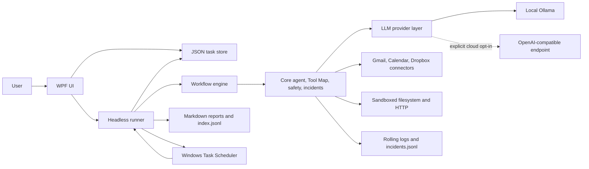

# OD.MyLocalAgent

OD.MyLocalAgent is a native Windows desktop application for running scheduled, AI-driven
tasks locally. It combines a WPF management UI, a headless runner, Ollama, deterministic
workflows, a guarded tool layer, and rolling Windows Task Scheduler registrations.

The default AI provider is local Ollama. An OpenAI-compatible provider is available only as
an explicit cloud opt-in. Published UI and runner executables are self-contained and are
installed in sibling `UI` and `Runner` directories so scheduled actions never depend on a
development `bin` directory.

Standalone offline HTML5 user guides are available in
[French](Docs/User-Manual.html) and [English](Docs/User-Manual.en.html). Each guide contains
its own navigation, search, styles, and scripts in one file.

## Product status

| Stage | Scope | Status |
|---|---|---|
| 0 | Solution foundation and toolchain | Complete |
| 1 | LLM providers and cloud connectors | Complete |
| 2 | Core services, tools, safety, incidents, scheduler | Complete |
| 3 | Workflows, reports, and headless runner | Complete |
| 4 | WPF shell, diagnostics, and settings | Complete |
| 5 | Task, prompt, connector, tester, and playground pages | Complete |
| 6 | Hardening, self-contained packaging, documentation, acceptance | Complete with documented human checks |

See [Docs/acceptance-report.md](Docs/acceptance-report.md) for the executed acceptance
evidence and any remaining environment-dependent checks.

## Prerequisites

- Windows 10 or Windows 11, x64 by default.
- PowerShell 7 or Windows PowerShell 5.1 for `scripts/publish.ps1`.
- .NET 10 SDK for building from source. The published applications are self-contained and do
  not require a separately installed .NET runtime.
- Ollama 0.32.5 or later, or another Ollama release that supports the configured
  `gemma4:12b` tag. Version 0.32.5 is the verified project baseline.
- A local model matching the exact configured tag:

```powershell
ollama --version
ollama pull gemma4:12b
ollama list
```

`ollama list` must contain `gemma4:12b`. A similar name or a different tag does not satisfy
the health check.

Google Cloud and Dropbox accounts are optional. They are required only for workflows that
enable those tool groups.

## Quick start

From the repository root, publish the self-contained UI and runner:

```powershell
.\scripts\publish.ps1
```

The default destination is:

```text
%LOCALAPPDATA%\Programs\OD.MyLocalAgent
```

The script publishes both projects in Release mode for `win-x64`, verifies the two
executables, copies `appsettings.json`, then prints the resolved runner path. A custom
destination or runtime identifier can be supplied:

```powershell
.\scripts\publish.ps1 `
  -DestinationPath 'D:\Apps\OD.MyLocalAgent' `
  -RuntimeIdentifier win-x64
```

Start:

```text
%LOCALAPPDATA%\Programs\OD.MyLocalAgent\UI\OD.MyLocalAgent.UI.exe
```

On first launch:

1. Open **Settings** and confirm the Ollama endpoint, model, filesystem root, scheduler
   options, and safety defaults. The Ollama model field is an editable list populated from
   the models installed on the configured endpoint; use **Refresh models** after changing the
   endpoint or installing a new model.
2. Select **Test connection**. A healthy result requires both a reachable endpoint and the
   exact configured model tag.
3. Open **Tools** to authorize Google or store Dropbox credentials when those integrations
   are needed.
4. Create a task. Prefer an explicit workflow for unattended execution.

The default `Settings -> Scheduler:RunnerPath` value is empty. This is intentional:
auto-resolution first checks beside the UI and then selects
`..\Runner\OD.MyLocalAgent.Runner.exe` in the standard published layout. An explicit
absolute override remains supported.

## Google Cloud OAuth setup

OD.MyLocalAgent requests these scopes:

| API | Scope |
|---|---|
| Gmail read | `https://www.googleapis.com/auth/gmail.readonly` |
| Gmail send | `https://www.googleapis.com/auth/gmail.send` |
| Calendar | `https://www.googleapis.com/auth/calendar` |

Configure Google Cloud as follows:

1. Create or select a Google Cloud project.
2. Enable the **Gmail API** and **Google Calendar API**.
3. Configure the OAuth consent screen. Add the intended account as a test user while the app
   remains in testing.
4. Create an OAuth client with application type **Desktop app**.
5. Close OD.MyLocalAgent and add the client id and client secret to
   `%LOCALAPPDATA%\OD.MyLocalAgent\settings.json`:

```json
{
  "Google": {
    "ClientId": "YOUR_DESKTOP_CLIENT_ID",
    "ClientSecret": "YOUR_DESKTOP_CLIENT_SECRET"
  }
}
```

The full settings file may contain other sections; do not remove them. Settings saves
preserve the `Google` section. Reopen the UI, go to **Tools**, and select **Connect**. The
interactive browser consent must be completed under the same Windows account that will run
scheduled tasks.

Refreshable Google authorization data is stored under:

```text
%LOCALAPPDATA%\OD.MyLocalAgent\Auth\Google
```

The runner never starts an interactive browser. If consent is missing or expired beyond
silent refresh, authorize again from the UI.

## Dropbox app setup

1. Create an app in the Dropbox App Console.
2. Choose the narrowest access type that covers the workflow, preferably an app folder.
3. Enable the file permissions required by the selected aliases: metadata read, content read,
   and content write as appropriate.
4. Obtain either:
   - an access token; or
   - a refresh token plus the app key.
5. In **Tools -> Dropbox**, enter the replacement values and select **Save credentials**.
6. Use **Test connection** before scheduling Dropbox workflows.

Dropbox values are write-only in the UI. They are persisted in the DPAPI CurrentUser secret
store, never in `settings.json`.

## Configuration and data locations

Configuration is loaded in this order, with later layers winning:

1. `appsettings.json` beside the executable, using `AppContext.BaseDirectory`.
2. `%LOCALAPPDATA%\OD.MyLocalAgent\settings.json`, optional and reloadable.
3. An in-memory layer populated from the DPAPI secret store at bootstrap.

The process working directory is never used to locate configuration.

| Location | Purpose |
|---|---|
| `%LOCALAPPDATA%\Programs\OD.MyLocalAgent\UI\` | Default self-contained WPF application directory |
| `%LOCALAPPDATA%\Programs\OD.MyLocalAgent\Runner\` | Default self-contained headless runner directory |
| `%LOCALAPPDATA%\OD.MyLocalAgent\settings.json` | Non-secret user overrides |
| `%LOCALAPPDATA%\OD.MyLocalAgent\secrets.dat` | DPAPI CurrentUser-protected OpenAI and Dropbox secrets |
| `%LOCALAPPDATA%\OD.MyLocalAgent\Auth\Google\` | Google OAuth token data |
| `%LOCALAPPDATA%\OD.MyLocalAgent\tasks\<id>.json` | One validated definition per task |
| `%LOCALAPPDATA%\OD.MyLocalAgent\reports\<taskId>\*.md` | Per-run Markdown reports |
| `%LOCALAPPDATA%\OD.MyLocalAgent\reports\index.jsonl` | Append-only execution index |
| `%LOCALAPPDATA%\OD.MyLocalAgent\logs\application-<date>.log` | Rolling application logs, retained for 14 files |
| `%LOCALAPPDATA%\OD.MyLocalAgent\logs\incidents.jsonl` | Durable incidents with correlation ids |
| `%LOCALAPPDATA%\OD.MyLocalAgent\logs\archive\<timestamp>\` | Log copies created by Diagnostics Reset |

The DPAPI keys are `OpenAI:ApiKey`, `Dropbox:AccessToken`, `Dropbox:RefreshToken`, and
`Dropbox:AppKey`. They must not be added to either JSON configuration file.

## Safety defaults

The following side effects are disabled by default:

| Alias | Required opt-in |
|---|---|
| `gmail.send` | `Safety:AllowSendEmail` |
| `filesystem.delete` | `Safety:AllowFileDelete` |
| `http.post` | `Safety:AllowHttpPost` |

A blocked operation throws `SafetyException` and names the required flag. This design keeps a
task definition, model response, or imported workflow from silently sending mail, deleting
files, or issuing outbound POST requests.

Filesystem aliases are additionally confined to the absolute `FileSystem:RootPath`. Rooted
inputs and parent traversal are rejected. `Http:AllowedHosts` is an exact hostname allowlist.
An empty list allows every HTTP or HTTPS host; that is convenient for interactive use but
increases unattended-network risk, so production tasks should use an explicit list.

Tool results such as email bodies, web pages, and local files are untrusted data. They may
contain prompt-injection text that asks the model to ignore policy, reveal secrets, or invoke
a dangerous tool. The agent system prompt explicitly tells the model never to treat tool
results as instructions. Safety flags, tool whitelists, the filesystem sandbox, and the HTTP
allowlist remain the enforceable boundaries even when model output is manipulated.

## Windows Task Scheduler

The JSON task store is the source of truth. Task Scheduler mirrors only each enabled task's
next cron occurrence:

- Folder: `OD.MyLocalAgent` by default.
- Registration name: `OD.MyLocalAgent.<taskId>`.
- Action: the published `OD.MyLocalAgent.Runner.exe run --task <taskId>`.
- Working directory: the published runner directory.
- `StartWhenAvailable = true`, so Windows can recover a missed start.
- After every `run`, the runner computes and registers the next occurrence.

This rolling-trigger design avoids relying on Task Scheduler's separate recurring-calendar
semantics. Run `resync-schedules` after restoring a task store, changing the publish path, or
repairing a deleted/stale registration.

The task editor provides plain-language presets for common schedules, a five-field cron guide,
live validation, and the next three local occurrences. Advanced cron expressions remain
editable directly.

With `Scheduler:RunWhenLoggedOff = false`, registrations use the current user's interactive
token. With it set to `true`, they use S4U. S4U cannot perform interactive OAuth consent:
complete Google consent in the UI first. The scheduled task must run as the same Windows
account because `%LOCALAPPDATA%`, Google tokens, and DPAPI secrets are user-specific.

## Runner CLI

```powershell
$runner = Join-Path $env:LOCALAPPDATA `
  'Programs\OD.MyLocalAgent\Runner\OD.MyLocalAgent.Runner.exe'

& $runner run --task daily-mail-summary
& $runner list
& $runner test-prompt --task daily-mail-summary
& $runner test-tool --alias filesystem.list --args '{ "path": "." }'
& $runner resync-schedules
```

| Command | Behavior |
|---|---|
| `run --task <id>` | Runs the workflow, or prompt when no workflow exists; writes report/index; rolls the schedule |
| `list` | Lists task id, name, cron, enabled state, and next run |
| `test-prompt --task <id>` | Runs only the prompt path, writes a report, and does not schedule |
| `test-tool --alias <alias> --args '<json>'` | Invokes one directly callable Tool Map alias with safety checks |
| `resync-schedules` | Recreates/refreshed enabled registrations and removes disabled or stale registrations |

Concurrent `run` commands for the same id are rejected by a global named execution gate.

| Exit code | Meaning |
|---:|---|
| `0` | Success |
| `1` | Task, tool, safety, or command-line failure |
| `2` | Configuration failure |
| `3` | Requested task not found |

## Task and workflow syntax

A task is stored as one JSON object:

```json
{
  "id": "daily-mail-summary",
  "name": "Daily mail summary",
  "schedule": "0 7 * * *",
  "prompt": "Summarize today's important messages.",
  "tools": ["gmail", "filesystem"],
  "workflow": [
    "gmail.readToday",
    "ai.summarize"
  ],
  "enabled": true,
  "errorPolicy": "StopOnError"
}
```

Task ids match `[a-z0-9-]+`. Cron is interpreted in the Windows local time zone. Tool groups
are `gmail`, `calendar`, `dropbox`, `filesystem`, and `http`.

String form is for steps without explicit arguments:

```json
"gmail.readToday"
```

Object form supplies arguments, an optional output id, and an optional error policy:

```json
{
  "step": "filesystem.write",
  "id": "writeReport",
  "args": {
    "path": "reports/mail-summary.md",
    "content": "{{summary.output}}"
  },
  "onError": "Retry",
  "retryCount": 3,
  "retryBackoffSeconds": 2
}
```

Supported policies are `StopOnError`, `ContinueOnError`, and `Retry`. Retry backoff is
exponential. String-form AI skills consume the previous step's output, or the task prompt
when first. Explicit `args.text` overrides that behavior.

Available placeholders are:

- `{{task.id}}`
- `{{task.name}}`
- `{{task.prompt}}`
- `{{previous.output}}`
- `{{<stepId>.output}}`

An unknown placeholder fails the step. If both `prompt` and `workflow` are present, the
workflow wins and the prompt remains available through `{{task.prompt}}`.

### Tool Map

| Workflow alias | Agent function | Implementation | Arguments | Safety |
|---|---|---|---|---|
| `gmail.readToday` | `gmail_read_today` | `GmailTool.ReadTodayAsync` | none | — |
| `gmail.readUnread` | `gmail_read_unread` | `GmailTool.ReadUnreadAsync` | none | — |
| `gmail.send` | `gmail_send` | `GmailTool.SendAsync` | `to`, `subject`, `body` | `Safety:AllowSendEmail` |
| `calendar.today` | `calendar_today` | `CalendarTool.TodayAsync` | none | — |
| `calendar.create` | `calendar_create` | `CalendarTool.CreateAsync` | `summary`, `start`, `end`, `description` | — |
| `dropbox.upload` | `dropbox_upload` | `DropboxTool.UploadAsync` | `localPath`, `dropboxPath` | — |
| `dropbox.download` | `dropbox_download` | `DropboxTool.DownloadAsync` | `dropboxPath`, `localPath` | — |
| `dropbox.list` | `dropbox_list` | `DropboxTool.ListAsync` | `folderPath` | — |
| `filesystem.list` | `filesystem_list` | `FileSystemTool.ListAsync` | `path` | — |
| `filesystem.read` | `filesystem_read` | `FileSystemTool.ReadAsync` | `path` | — |
| `filesystem.write` | `filesystem_write` | `FileSystemTool.WriteAsync` | `path`, `content` | — |
| `filesystem.move` | `filesystem_move` | `FileSystemTool.MoveAsync` | `from`, `to` | — |
| `filesystem.delete` | `filesystem_delete` | `FileSystemTool.DeleteAsync` | `path` | `Safety:AllowFileDelete` |
| `filesystem.createDirectory` | `filesystem_create_directory` | `FileSystemTool.CreateDirectoryAsync` | `path` | — |
| `http.get` | `http_get` | `HttpTool.GetAsync` | `url` | — |
| `http.post` | `http_post` | `HttpTool.PostAsync` | `url`, `body`, `contentType` | `Safety:AllowHttpPost` |
| `http.getText` | `http_get_text` | `HttpTool.GetTextAsync` | `url` | — |
| `ai.summarize` | — | `SummarizeTextSkill` | optional `text` | — |
| `ai.extractActionItems` | — | `ExtractActionItemsSkill` | optional `text` | — |
| `ai.classifyEmail` | — | `ClassifyEmailSkill` | optional `text` | — |
| `ai.prompt` | — | workflow prompt step | required `prompt` | — |

### Example: mail summary to a report file

```json
{
  "id": "daily-mail-summary",
  "name": "Daily mail summary",
  "schedule": "0 7 * * *",
  "prompt": "Summarize today's messages and highlight required actions.",
  "tools": ["gmail", "filesystem"],
  "workflow": [
    "gmail.readToday",
    {
      "step": "ai.summarize",
      "id": "summary"
    },
    {
      "step": "filesystem.write",
      "id": "writeReport",
      "args": {
        "path": "reports/daily-mail-summary.md",
        "content": "{{summary.output}}"
      }
    }
  ],
  "enabled": true,
  "errorPolicy": "StopOnError"
}
```

### Example: unread mail to Calendar and Dropbox

This example reads unread mail, extracts actions, creates a review event, writes the report
inside the filesystem sandbox, and backs it up to Dropbox:

```json
{
  "id": "unread-mail-follow-up",
  "name": "Unread mail follow-up",
  "schedule": "0 9 * * 1-5",
  "prompt": "Extract concrete follow-up actions from unread messages.",
  "tools": ["gmail", "calendar", "filesystem", "dropbox"],
  "workflow": [
    "gmail.readUnread",
    {
      "step": "ai.extractActionItems",
      "id": "actions"
    },
    {
      "step": "calendar.create",
      "id": "calendarEvent",
      "args": {
        "summary": "Review unread mail actions",
        "start": "2026-07-30T09:00:00+02:00",
        "end": "2026-07-30T09:30:00+02:00",
        "description": "{{actions.output}}"
      }
    },
    {
      "step": "filesystem.write",
      "id": "report",
      "args": {
        "path": "reports/unread-actions.md",
        "content": "{{actions.output}}"
      }
    },
    {
      "step": "dropbox.upload",
      "args": {
        "localPath": "reports/unread-actions.md",
        "dropboxPath": "/OD.MyLocalAgent/unread-actions.md"
      }
    }
  ],
  "enabled": true,
  "errorPolicy": "StopOnError"
}
```

`calendar.create` expects explicit ISO 8601 timestamps. Generate task-specific dates before
unattended use rather than copying the example dates unchanged.

### OAuth-free acceptance sample

When Google consent is unavailable, copy
`Docs\samples\acceptance-filesystem.json` to the task directory and run:

```powershell
Copy-Item `
  -LiteralPath '.\Docs\samples\acceptance-filesystem.json' `
  -Destination (Join-Path $env:LOCALAPPDATA `
    'OD.MyLocalAgent\tasks\acceptance-filesystem.json')
& $runner run --task acceptance-filesystem
```

This deterministic sample creates, writes, and reads a file under `FileSystem:RootPath`, then
writes the normal Markdown report, appends `reports\index.jsonl`, and rolls the next scheduler
registration. It validates the local execution pipeline but does not validate Gmail OAuth;
the Gmail leg of `daily-mail-summary` still requires a separate human-authorized run.

## Architecture



Project dependencies are acyclic:

```text
Ollama      -> none
Connectors  -> none
Core        -> Ollama, Connectors
Workflows   -> Core
Runner      -> Workflows, Core
UI          -> Workflows, Core, Ollama
Tests       -> all projects
```

The UI **Run now** action starts the published runner instead of executing a separate
in-process path. Scheduled and interactive runs therefore share the same behavior.

## Provider switching

The Settings page can switch between:

- **Ollama**, local and default.
- **OpenAI-compatible**, cloud and opt-in.

Save the new provider and select **Test connection**. The factory reads monitored options on
every creation, so the next test or task uses the new provider without restarting the UI.
Already-running executions are not interrupted.

The AI playground uses raw completion by default. **Allow Tools** switches it to agent mode
with all five tool groups, while **Allow Skills** exposes the built-in summarize, action-item,
and email-classification skills. The filesystem sandbox, tool safety flags, connector
configuration, and HTTP allowlist continue to apply in the playground.

The OpenAI API key replacement field is write-only and saved only through DPAPI. Verify
`%LOCALAPPDATA%\OD.MyLocalAgent\settings.json` after a provider test: it may contain provider,
endpoint, model, and timeout, but must not contain `ApiKey`.

The optional Light appearance remains available by explicit product choice. Dark is the
default and the hardened audit target; both palettes use the same semantic resources.

## Diagnostics and incidents

**Settings -> Diagnostics -> Save to disk** exports the complete current in-memory log view
to a selected `.log` file. **Reset** requires confirmation, clears the in-memory view, copies
rolling logs to a timestamped archive, and truncates the active rolling files.

All handled failures enter one incident pipeline. Each JSONL record contains a UTC timestamp,
severity, source page or task id, message, full stack trace, and correlation id. The UI shows
the correlation id in a non-blocking snackbar and remains usable.

## Troubleshooting

### Ollama is down

Run `ollama list` and ensure the Ollama service is running. Confirm
`Ollama:Endpoint` is normally `http://localhost:11434`. Test connection reports the real
transport failure and latency rather than silently falling back to cloud AI.

### The model tag is missing

Run:

```powershell
ollama pull gemma4:12b
ollama list
```

The configured tag and listed tag must match exactly. Change `Ollama:Model` only when the
replacement model is installed.

### Google consent loops or fails in a headless run

Consent is interactive and must be completed from **Tools -> Connect** while logged on
normally. S4U and the runner cannot open consent. Confirm the OAuth client is a Desktop app,
the account is an allowed test user, the requested APIs/scopes are enabled, and the scheduled
task uses the same Windows account.

### A safety block is reported

Read the named `Safety:*` flag in the error. Enable it only after reviewing the workflow,
tool whitelist, destination, and untrusted inputs. For `http.post`, also constrain
`Http:AllowedHosts`.

### The runner cannot be found

Republish with `scripts/publish.ps1`. Leave `Scheduler:RunnerPath` empty for the side-by-side
sibling-directory layout, or set it to the absolute published runner path. Run
`resync-schedules` after changing the path.

### A schedule is missing or stale

Run:

```powershell
& $runner resync-schedules
& $runner list
```

Then inspect `\OD.MyLocalAgent\OD.MyLocalAgent.<taskId>` in Windows Task Scheduler and verify
that its action points to the stable published runner.

### Where to investigate failures

- Normal logs: `%LOCALAPPDATA%\OD.MyLocalAgent\logs\application-<date>.log`
- Incident records: `%LOCALAPPDATA%\OD.MyLocalAgent\logs\incidents.jsonl`
- Run index: `%LOCALAPPDATA%\OD.MyLocalAgent\reports\index.jsonl`
- Per-task report: `%LOCALAPPDATA%\OD.MyLocalAgent\reports\<taskId>\`

## Extension points

### Add a tool

1. Add an interface and implementation in Core with asynchronous methods, cancellation, XML
   documentation, validation, and sanitized structured logging.
2. Add exactly one entry to `ToolMap.Definitions`; do not create a second alias table.
3. Register the implementation in `AddODServices`.
4. Add the tool group to task validation only if it is a new group.
5. Extend Tool Map consistency, argument-binding, whitelist, and safety tests.
6. Document the alias and any new side-effect gate.

### Add a skill

1. Derive a new no-tools prompt template from `SkillBase`.
2. Give it a stable `ISkill.Name`.
3. Register both its concrete type and `ISkill` projection in `AddODServices`.
4. Add an `ai.<name>` Tool Map entry.
5. Test explicit `args.text` and implicit previous-output behavior.

## Build and test

```powershell
dotnet restore OD.MyLocalAgent.sln -m:1
dotnet build OD.MyLocalAgent.sln -m:1 --no-restore --configuration Release
dotnet test OD.MyLocalAgent.sln -m:1 --no-build --no-restore --configuration Release
```

Warnings are errors. All public APIs require English XML documentation.
